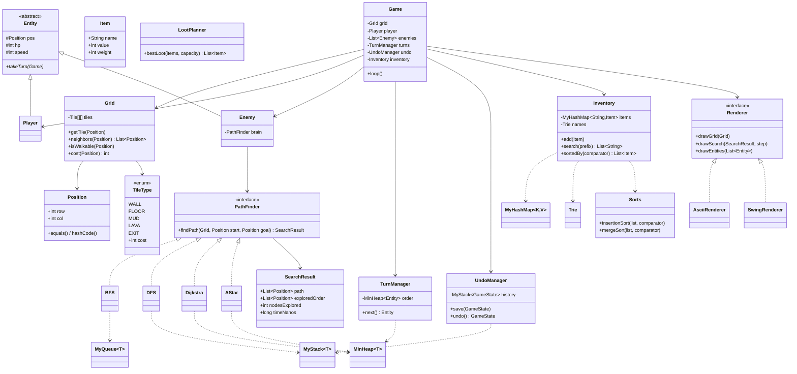
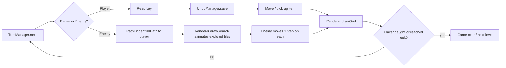

# Dungeon Project — Plan

A grid-based dungeon game where enemies hunt you using real pathfinding, and you can **watch the algorithms think**. Every CS 113 topic gets used for something real in the game.

> **Goal:** Write the data structures yourself (stack, queue, heap, hash map, trie). Only use Java's built-in versions to *test* yours against.

---

## 1. What you're building (feature list)

- A dungeon map (2D grid) with walls, floor, mud/lava (costs more to cross), loot, and exits
- A player you move with WASD, with **undo**
- Enemies that chase you using BFS / DFS / Dijkstra / A* (switchable)
- A visualizer that shows the frontier, visited tiles, and final path while a search runs
- Turn order based on speed (priority queue)
- An inventory you can sort and search (autocomplete)
- A "best loot route" solver using dynamic programming
- A stats panel comparing algorithms (nodes explored, time taken)

---

## 2. Code structure



### Suggested folders

```
DungeonProject/
├── plan.md
└── src/
    ├── Main.java
    ├── model/      Position, TileType, Tile, Grid, Entity, Player, Enemy, Item
    ├── ds/         MyStack, MyQueue, MinHeap, MyHashMap, Trie
    ├── algo/       PathFinder, SearchResult, BFS, DFS, Dijkstra, AStar, Sorts, LootPlanner
    ├── game/       Game, TurnManager, UndoManager, GameState, Inventory
    └── view/       Renderer, AsciiRenderer, SwingRenderer
```

**Key design idea:** algorithms never draw anything. They return a `SearchResult` containing `exploredOrder`, and the `Renderer` replays that list one step at a time. That keeps the logic testable and lets you swap ASCII ↔ Swing ↔ web without touching the algorithms.

### One game turn



---

## 3. What to code — topic by topic

Each item: **what to build → where it's used → sources**.

### 3.1 Graphs (the grid *is* a graph)
- **Build:** `Grid.neighbors(pos)` returns the up/down/left/right tiles that aren't walls. Each tile is a node; each neighbor is an edge; `TileType.cost` is the edge weight.
- **Used for:** every pathfinding algorithm.
- **Sources:**
  - Your lessons: [graph intro](../pages-lessons/cs113/notebooks/2025-05-22-graph-heuristics-intro.ipynb), [Java graph](../pages-lessons/cs113/notebooks/2025-05-24-javagraph.ipynb), [graph doc](../pages-lessons/cs113/docs/2025-05-23-graph.md)
  - [Red Blob Games – Grids and Graphs](https://www.redblobgames.com/pathfinding/grids/graphs.html)

### 3.2 Stack — `MyStack<T>`
- **Build:** `push`, `pop`, `peek`, `isEmpty`, `size` (linked list or resizing array).
- **Used for:** undo (`UndoManager`), DFS.
- **Sources:**
  - Your lessons: [RPN calculator](../pages-lessons/cs113/notebooks/2026-03-05-rpn_calculator.ipynb) (stack-based)
  - [Java `Deque` docs](https://docs.oracle.com/en/java/javase/21/docs/api/java.base/java/util/Deque.html) (to compare against)
  - [VisuAlgo – Linked List / Stack / Queue](https://visualgo.net/en/list)

### 3.3 Queue — `MyQueue<T>`
- **Build:** `enqueue`, `dequeue`, `peek`, `isEmpty` (linked list with head + tail).
- **Used for:** BFS.
- **Sources:**
  - Your lessons: [Queue / Dequeue](../pages-lessons/cs113/notebooks/2025-04-10-queue-dequeue.ipynb)
  - [Java `Queue` docs](https://docs.oracle.com/en/java/javase/21/docs/api/java.base/java/util/Queue.html)

### 3.4 Hash table — `MyHashMap<K, V>`
- **Build:** array of buckets + chaining, `put`, `get`, `containsKey`, `remove`, resize when load factor > 0.75. `Position` must override `equals()` and `hashCode()`.
- **Used for:** `visited` set and `cameFrom` map in searches, inventory lookup by name.
- **Sources:**
  - Your lessons: [hash table layers](../pages-lessons/cs113/notebooks/2026-10-10-hash-table-layers-draft.ipynb)
  - [Java `HashMap` docs](https://docs.oracle.com/en/java/javase/21/docs/api/java.base/java/util/HashMap.html)
  - [`Object.hashCode` contract](https://docs.oracle.com/en/java/javase/21/docs/api/java.base/java/lang/Object.html#hashCode())
  - [VisuAlgo – Hash Table](https://visualgo.net/en/hashtable)

### 3.5 Sets
- **Build:** a `MySet<T>` wrapper over `MyHashMap` (or just use the map's keys).
- **Used for:** visited tiles, item tags (e.g. "magic", "weapon"), tiles the player has already seen (fog of war).
- **Sources:**
  - Your lessons: [collectables – sets](../pages-lessons/cs113/notebooks/2025-04-10-data_structures-collectables-sets.ipynb), [collections](../pages-lessons/cs113/notebooks/2026-10-18-collections.ipynb)
  - [Java `Set` docs](https://docs.oracle.com/en/java/javase/21/docs/api/java.base/java/util/Set.html)

### 3.6 Heap / Priority queue — `MinHeap<T>`
- **Build:** array-backed binary heap with a `Comparator<T>`: `add` (sift up), `poll` (sift down), `peek`, `isEmpty`.
- **Used for:** Dijkstra, A*, and `TurnManager` (fastest entity goes first).
- **Sources:**
  - Your lessons: [heap & priority queue](../pages-lessons/cs113/notebooks/2026-10-10-heap-priority-queue-draft.ipynb)
  - [Java `PriorityQueue` docs](https://docs.oracle.com/en/java/javase/21/docs/api/java.base/java/util/PriorityQueue.html)
  - [VisuAlgo – Binary Heap](https://visualgo.net/en/heap)

### 3.7 Trees — `Trie`
- **Build:** `insert(word)`, `startsWith(prefix)` returning all matching words.
- **Used for:** inventory search / command autocomplete (`"pot"` → `potion`, `pottery`).
- **Stretch:** a BST of high scores.
- **Sources:**
  - Your lessons: [tree layers](../pages-lessons/cs113/notebooks/2026-10-10-tree-layers-draft.ipynb)
  - [Wikipedia – Trie](https://en.wikipedia.org/wiki/Trie)
  - [VisuAlgo – BST](https://visualgo.net/en/bst)

### 3.8 Pathfinding — BFS, DFS, Dijkstra, A*
All four implement `PathFinder` and return a `SearchResult`. They share the same shape — only the "frontier" data structure changes:

| Algorithm | Frontier | Finds shortest? | Uses weights? |
|---|---|---|---|
| DFS | `MyStack` | No | No |
| BFS | `MyQueue` | Yes (fewest steps) | No |
| Dijkstra | `MinHeap` by distance so far | Yes | Yes |
| A* | `MinHeap` by distance + heuristic | Yes | Yes |

- **Build:** each algorithm records every tile it pulls off the frontier into `exploredOrder`, and rebuilds the path from a `cameFrom` map.
- **A\* heuristic:** Manhattan distance `|r1 - r2| + |c1 - c2|`.
- **Sources:**
  - Your lessons: [graph heuristics – searches](../pages-lessons/cs113/notebooks/2025-05-22-graph-heuristics-searches.ipynb), [search graph](../pages-lessons/cs113/notebooks/2025-05-24-search_graph.ipynb)
  - [Red Blob Games – Introduction to A*](https://www.redblobgames.com/pathfinding/a-star/introduction.html) ⭐ best visual explanation
  - [Red Blob Games – Implementation notes](https://www.redblobgames.com/pathfinding/a-star/implementation.html)
  - [Wikipedia – Dijkstra's algorithm](https://en.wikipedia.org/wiki/Dijkstra%27s_algorithm)
  - [Wikipedia – A* search](https://en.wikipedia.org/wiki/A*_search_algorithm)
  - [VisuAlgo – Graph traversal (BFS/DFS)](https://visualgo.net/en/dfsbfs)

### 3.9 Sorting — `Sorts`
- **Build:** `insertionSort` and `mergeSort`, both generic with a `Comparator<T>`.
- **Used for:** sort inventory by value / weight / name; sort leaderboard.
- **Analysis:** time both on 10, 1,000, and 100,000 random items and graph the results.
- **Sources:**
  - Your lessons: [selection & insertion](../pages-lessons/cs113/notebooks/2025-01-06-sort-selection_insertion.ipynb), [merge sort](../pages-lessons/cs113/notebooks/2025-01-06-sort-merge.ipynb), [advanced sort analysis](../pages-lessons/cs113/notebooks/2026-10-10-advanced-sort-analysis-draft.ipynb)
  - [Java `Comparator` docs](https://docs.oracle.com/en/java/javase/21/docs/api/java.base/java/util/Comparator.html)
  - [VisuAlgo – Sorting](https://visualgo.net/en/sorting)

### 3.10 Dynamic programming — `LootPlanner`
- **Build (pick one or both):**
  - **Knapsack:** your bag holds weight `W`; pick items for max value. Fill a `dp[items+1][W+1]` table.
  - **Max-loot path:** moving only right/down across a room, collect the most `$`. `dp[r][c] = loot[r][c] + max(dp[r-1][c], dp[r][c-1])`.
- **Used for:** a "suggest best loot" button; visualize the DP table filling in.
- **Sources:**
  - Your lessons: [dynamic programming](../pages-lessons/cs113/notebooks/2026-10-10-dynamic-programming-draft.ipynb)
  - [Wikipedia – Knapsack problem](https://en.wikipedia.org/wiki/Knapsack_problem)
  - [VisuAlgo – Recursion / DP](https://visualgo.net/en/recursion)

### 3.11 Algorithm analysis
- **Build:** a `Stats` screen/printout that runs all four pathfinders on the same map and prints `nodesExplored` and `timeNanos` (`System.nanoTime()`).
- **Write up:** Big-O of each structure/algorithm you wrote, and whether your measurements match.
- **Sources:**
  - [Big-O Cheat Sheet](https://www.bigocheatsheet.com/)
  - [`System.nanoTime` docs](https://docs.oracle.com/en/java/javase/21/docs/api/java.base/java/lang/System.html#nanoTime())

---

## 4. Visualization

Use one color/symbol scheme everywhere:

| Thing | ASCII | Color |
|---|---|---|
| Wall | `#` | dark gray |
| Floor | `.` | black |
| Mud / lava | `~` / `^` | brown / red |
| Player / enemy | `@` / `E` | white / red |
| Frontier (in queue/heap) | `?` | yellow |
| Visited | `o` | light blue |
| Final path | `*` | green |
| Loot | `$` | gold |

### Stage 1 — ASCII (`AsciiRenderer`)
Reprint the grid every step, `Thread.sleep(100)` between frames. Clear screen with `System.out.print("\033[H\033[2J")`.

### Stage 2 — Swing (`SwingRenderer`)
A `JPanel` that overrides `paintComponent` and `fillRect`s each tile; a `javax.swing.Timer` advances one step of `exploredOrder` and calls `repaint()`.
- [Oracle – Performing Custom Painting](https://docs.oracle.com/javase/tutorial/uiswing/painting/index.html)
- [Oracle – How to Use Swing Timers](https://docs.oracle.com/javase/tutorial/uiswing/misc/timer.html)
- [`KeyListener` docs](https://docs.oracle.com/en/java/javase/21/docs/api/java.desktop/java/awt/event/KeyListener.html)

### Stage 3 (stretch) — Web
Spring Boot endpoint returns `SearchResult` as JSON; an HTML `<canvas>` on your site animates it. Could plug into the existing engine in `assets/js/GameEnginev1`.
- [Spring – Building a RESTful Web Service](https://spring.io/guides/gs/rest-service)
- [MDN – Canvas tutorial](https://developer.mozilla.org/en-US/docs/Web/API/Canvas_API/Tutorial)

### Extra panels worth adding
- Algorithm toggle + "nodes explored" counter (BFS vs A* on the same map)
- Step button / speed slider
- Live list of what's in the heap right now
- Undo stack and turn-order queue shown as small lists

---

## 5. Build order (checklist)

- [ ] **1. Grid** — `Position`, `TileType`, `Grid`; load a map from a text file; `AsciiRenderer.drawGrid`
- [ ] **2. Player** — WASD movement, wall collision
- [ ] **3. `MyStack` + undo** — `UndoManager`, press `U` to undo
- [ ] **4. `MyQueue` + BFS** — enemy chases you; animate `exploredOrder`
- [ ] **5. `MyHashMap`** — replace any `HashMap`/`HashSet` you used in BFS
- [ ] **6. DFS** — compare with BFS (DFS paths look silly — that's the point)
- [ ] **7. `MinHeap` + Dijkstra** — add mud/lava costs
- [ ] **8. A\*** — Manhattan heuristic; compare explored counts with Dijkstra
- [ ] **9. `TurnManager`** — multiple enemies with different speeds
- [ ] **10. Inventory** — items, `Trie` search, `mergeSort`/`insertionSort` by value/weight
- [ ] **11. `LootPlanner`** — knapsack and/or max-loot path
- [ ] **12. Stats** — run all pathfinders, time sorts, write Big-O notes
- [ ] **13. Swing** — `SwingRenderer` with colors and animation
- [ ] **14. Stretch** — web version, procedural map generation, fog of war

### Testing tip
For every data structure you write, test it against Java's version with the same random inputs:
```java
// e.g. MinHeap vs PriorityQueue
for (int i = 0; i < 1000; i++) { int x = rand.nextInt(); mine.add(x); real.add(x); }
while (!real.isEmpty()) assert mine.poll().equals(real.poll());
```
